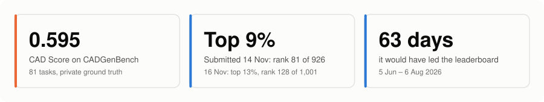
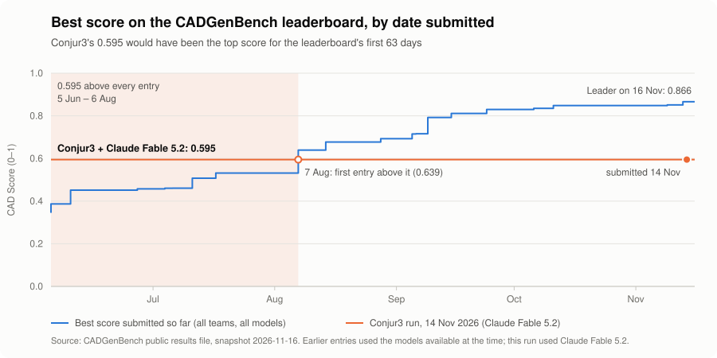
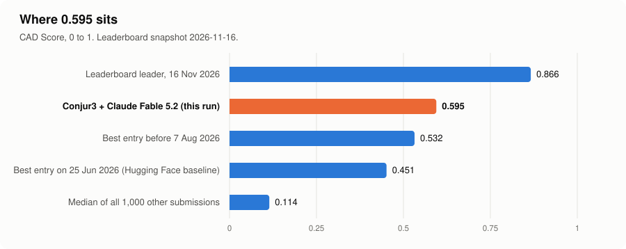
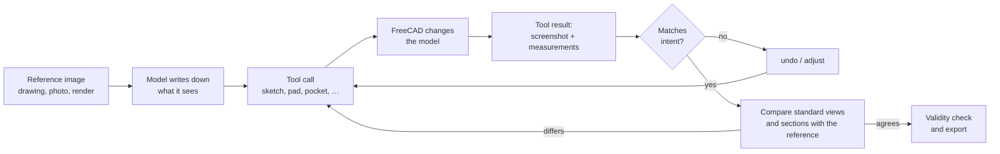

# Conjur3

[](./LICENSE)

The web application and API backing **[Conjur3](https://conjur3.com)** —
_autonomous parametric CAD for manufacturing_. Organizations get **seats**
(via Stripe, platform grants, or seat-voucher links); admins share **invite
links**; each engineer **mints their own API key** — shown once, stored hashed,
self-revocable. Built on Next.js 15 + Firebase with seat-based Stripe billing.

This repository holds the whole stack: the **`conjur3-pilot` MCP server and
FreeCAD addon** ([`conjur3/`](./conjur3/README.md)) that let an AI agent drive a
live FreeCAD session, the **MCP gateway** and **connector** that relay a hosted
MCP to a user's machine, and the **web app + Cloud Functions** for seats and keys.

> **Setup, run, and deploy instructions live in [SETUP.md](./SETUP.md).**

---

## Benchmark result

<picture>
  <source media="(prefers-color-scheme: dark)" srcset="./benchmark/img/cadgenbench-banner-dark.svg">
  
</picture>

Conjur3 driving FreeCAD, with Claude Fable 5.2 as the model, scored **0.595**
on [CADGenBench](https://huggingface.co/spaces/HuggingAI4Engineering/CADGenBench),
a public benchmark of 81 mechanical-part tasks graded against ground truth that
only the leaderboard holds.

**This is our run.** The leaderboard row is anonymous: its submitter name is
`119cb699ce2e2635e780d4373d5c959ae49061be2320caafb25803c09a1297a1`, the SHA-256 of `wberry@listeningpost.ai`. Listeningpost.ai claims it as
the Conjur3 run described here. To check the match:
`printf %s 'wberry@listeningpost.ai' | sha256sum`.

| | CAD Score | Valid parts |
| --- | --- | --- |
| **Overall** | **0.595** | 74 of 81 |
| Generation: build a part from an engineering drawing | 0.574 | 47 of 49 |
| Editing: apply a change to an existing STEP file | 0.626 | 27 of 32 |

- **Top 13% of the leaderboard.** Rank 128 of 1,001 scored submissions on
  16 November 2026, and 29th of 168 teams counting each team's best run. On
  the day it was submitted (14 November) it ranked 81 of 926, the top 9%.
- **Editing is the stronger half.** At 0.626 on editing tasks, it is ahead of
  85% of all submissions on that task type.
- **Ahead of 20 of the 22 baseline runs** on the leaderboard (single-model
  build123d agents, mostly from Hugging Face and Mecado), and 32% above
  Hugging Face's best baseline (Claude Fable 5, 0.451).

### Had we released it in June

<picture>
  <source media="(prefers-color-scheme: dark)" srcset="./benchmark/img/cadgenbench-timeline-dark.svg">
  
</picture>

Conjur3's CAD tools were finished in June 2026: the MCP server and FreeCAD
addon were last changed on 2 June, and the last commit to Conjur3's private
development repository before the open-source release was on 25 June. This
public repository starts from a single commit of the released code; the
development history is not published. The leaderboard's earliest
submissions are dated 5 June.

Set against the leaderboard's own history, a score of 0.595 would have been
**the highest on the leaderboard every day from 5 June to 6 August 2026**, 63
days. On 25 June it would have ranked first of 40 submissions, 32% above the
best entry then (0.451). The first entry to pass it arrived on 7 August
(0.639); the best before that was 0.532.

This is a comparison with the past, not a result from it, and it needs three
qualifications:

- **The model is newer than the comparison.** We ran the benchmark in
  November 2026 with Claude Fable 5.2, the strongest model available to us
  today. It was released on 9 November 2026, so it was not available in June
  or July. The entries we compare against used the models
  of their day. What the comparison does show is that the score is well above
  anything any team had submitted in that period.
- **We did not run the benchmark in June,** so this is not a measurement of
  what Conjur3 would have scored then.
- **The tool code is from June, with one unintended change.** The MCP server
  and addon were unchanged from 2 June until 13 November. That day we asked an
  AI coding agent (Claude Code) to prepare everything needed to run the
  benchmark. While doing so it noticed a bug in `cross_section`, which
  returned an unusable image, and made the decision on its own to rewrite the
  tool so it shows the part cut open with the section profile in red. We had
  not asked for that change. It is in the scored run, and it affects what the
  model sees when it inspects a section: the model called `cross_section` 72
  times, in 48 of the 81 tasks. Apart from it, the CAD tools behave
  as they did in June. The other 13 November changes were:
  - the benchmark harness and prompts in [`benchmark/`](./benchmark/README.md),
    which the model followed;
  - fixes needed to run in the Docker image, none of which change what a tool
    does: the container's startup flags, a pin on the `mcp` library,
    compatibility with FreeCAD 0.21 in two tools written for 1.0
    (`create_sketch_offset` and `countersunk_hole`), and
    enforcement of the documented `MCP_AUTH_TOKEN`;
  - open-source preparation in the web app and documentation, outside the CAD
    tools.

We are publishing this because the approach is the point: give a model a live
parametric CAD kernel, show it a screenshot and the kernel's measurements after
every change, and make it check its work against the drawing. Teams with more
resources than ours can take that further, and we hope this helps them.

### Where it stands today

<picture>
  <source media="(prefers-color-scheme: dark)" srcset="./benchmark/img/cadgenbench-standing-dark.svg">
  
</picture>

The leaderboard has moved on: the top entry on 16 November scores 0.866, and
28 teams have a better best run than ours. Four of the five other entries that
name Claude Fable 5.2 score higher, so with the same model, the harness and
prompting around it account for a large difference.

### How the run was made

| | |
| --- | --- |
| Leaderboard entry | `anonymous-agent-setup + claude-fable-5-2`, submitted 14 Nov 2026, 16:22 UTC, under submitter name `119cb699ce2e2635e780d4373d5c959ae49061be2320caafb25803c09a1297a1` (SHA-256 of `wberry@listeningpost.ai`). Unvalidated: the maintainers have not reviewed it. All 81 STEP files in the scored submission are byte-identical to the run's output. |
| Code | Commit `69e4bb3` of the private development repository, FreeCAD 0.21.2 in the Docker image. The CAD tools and benchmark harness here are that code; the only later changes to them are comments and repository URLs. |
| Agent | Claude Code 2.1.323 (24 tasks) and 2.1.325 (57 tasks; it auto-updated between passes), model `claude-fable-5-2` on every task, prompt style `tools`. Run with the host's normal Claude Code configuration rather than `--bare`; the model's only tools were Read and the 70 Conjur3 tools. |
| Attempts | One per task, 30-minute limit; no task timed out. Three passes between 13 Nov 19:49 UTC and 14 Nov 09:28 UTC. 57 tasks first failed only because the Claude subscription's usage limit was reached (55 within seconds of starting, 2 cut off mid-build) and were rerun after the limit reset. No task was rerun for any other reason. |
| Usage | 3.9 agent-hours; $146.54 API-equivalent cost as reported by Claude Code. Both exclude the two attempts cut off mid-build (about 8 minutes; their cost was not recorded). |
| Validity | All 81 parts passed the harness's local check in FreeCAD; the leaderboard's stricter gate rejected 7, which score zero above. |

Every number in this section comes from the leaderboard's public
[results file](https://huggingface.co/datasets/HuggingAI4Engineering/cadgenbench-submissions)
as of 16 November 2026. To regenerate the figures:
`python3 benchmark/make_charts.py results.jsonl benchmark/img`. To run the
benchmark yourself, see [`benchmark/README.md`](./benchmark/README.md).

---

## What it does

- **Conjur3-branded UI** — dark "ink" theme, mint/amber accents, stencil display
  type, matching conjur3.com.
- **Seat-based subscriptions** via the official Firebase Stripe Extension
  (`stripe/firestore-stripe-payments`). A subscription's quantity = the org's seats.
- **Roles**: **Owner** (the organization — owns billing) → **Admin** (manages the
  team) → **Member/User** (mints their own key for access). Users may belong to
  **multiple organizations**.
- **Self-service API keys**: members mint/rotate/revoke/delete their own key per
  org. Plaintext is shown exactly once; Firestore stores only a SHA-256 hash +
  display stub. Admins see metadata and can revoke — never read — keys.
- **Invites, not codes**: org admins share join links (or email single-use
  links); platform admins issue seat-voucher links that add seats to an existing
  org or spin up a new one.
- **Trusted server logic** in Cloud Functions (membership/roles, key lifecycle,
  invites, billing sync) — never the client, and no custom claims.
- **Optional Redis layer** for gateway entitlement caching and rate limiting,
  with a one-command local Docker setup and a fail-open design.

## Tech stack

| Layer | Technology |
| ----- | ---------- |
| Framework | Next.js 15 (App Router), React 19, TypeScript |
| Styling | Tailwind CSS v4 (`@theme` design tokens) |
| Auth / data | Firebase Authentication + Firestore |
| Server logic | Firebase Cloud Functions (Node 22, Admin SDK) |
| Billing | Stripe via `firestore-stripe-payments` extension |
| Cache / limits | Redis (ioredis) — optional, Docker for local |

## Quick start

```bash
make install     # web app + functions + MCP gateway deps
make dev         # Redis + emulators + seed + conjur3-pilot + gateway + web
```
`make dev` brings up the whole stack and seeds runtime config only (no accounts).
**Sign up** at http://localhost:3000 to create your account/org; emails listed
in `PLATFORM_ADMIN_EMAILS` (see `functions/.env.demo-conjur3.example`) become
platform admins on verified sign-up. The premium MCP is
gated at http://localhost:8090/mcp. `make help` lists every target;
`SKIP_FREECAD=1 make dev` if you have no local FreeCAD.

**Customer onboarding (connect Claude Code + install the connector): [ONBOARDING.md](./ONBOARDING.md).**
**Full dev + production runbook (Firebase + GCP VM): [DEPLOYMENT.md](./DEPLOYMENT.md).**
The [SETUP.md](./SETUP.md) has the manual/per-piece details and the original
end-to-end flow.

## Project layout

```
src/app/            routes: / signin signup onboarding dashboard invite join billing admin platform
src/app/api/        route handlers: /api/health
src/components/     Conjur3 UI kit (Logo, Button, Nav, Card, Field, …)
src/context/        AuthContext (user + live multi-org memberships)
src/hooks/          useRequireAuth (route guard), useOrg
src/lib/            callables, redis, cache, types
functions/src/      Cloud Functions: organizations, seatKeys, members, orgInvites,
                    guidedInvites, billing, dev
scripts/            deploy helpers + migrate-keys.mjs (one-time hash migration)
benchmark/          CADGenBench harness: runner, prompts, packaging (see benchmark/README.md)
conjur3/            conjur3-pilot MCP server, FreeCAD addon, skills, Docker image
firestore.rules     security rules (clients read; Functions write)
firebase.json       emulators, functions, hosting, firestore config
docker-compose.yml  local Redis + redis-commander
```

---

## How Conjur3 guides the model with images

A language model cannot see the part it is building unless something shows it.
Conjur3 is built around showing it, on every step, and around prompts that
tell the model how to use what it is shown. This section describes the
mechanism and the prompting practices we use with it. The code is in
[`conjur3/conjur3-pilot`](./conjur3/conjur3-pilot); the prompts are in
[`benchmark/prompts`](./benchmark/prompts) and
[`conjur3/conjur3-pilot/skills`](./conjur3/conjur3-pilot/skills).

### The loop



### What the model is shown

**A screenshot after every change.** Every MCP tool that modifies the model
returns two things in the same result: a text summary and a PNG of the live
3D viewport, fitted to the part, from the isometric view. The model's next
decision is therefore made with a picture of the consequence of its last one.
Nothing has to ask for it. (`conjur3-pilot --only-text-feedback` turns the
images off for text-only models.)

**Numbers alongside the picture.** Feature-creating tools also return a
`measurements` block read from the CAD kernel: bounding box, volume, face,
edge and vertex counts, and whether the solid is valid. A picture shows
whether the shape is right; it cannot show whether a part is 40 mm or 42 mm
long. The numbers can, and they arrive in the same result.

**More views when one is not enough.** An isometric view hides the back and
the inside. These tools return images on request:

| Tool | What comes back | Use it for |
| --- | --- | --- |
| `capture_views` | Top, Front, Right and Isometric, each labelled, in one call | Comparing against a drawing's orthographic views; long thin parts where the isometric view says little |
| `capture_viewport` | One of nine standard views, optionally framed on one object and at a chosen size | A specific side, or a close look at a small feature |
| `cross_section` | The part sliced on a plane, with the cut profile drawn in red, plus the count and area of the closed profiles | Bores, pockets, wall thickness, internal channels: anything invisible from outside |
| `isolate_object`, `set_visibility`, `zoom_object` | A screenshot with other parts hidden, or framed on one part | Parts hidden behind other parts in an assembly |
| `query_sketch` | Closed-profile count and areas for a sketch, plus a screenshot | Checking a sketch is the closed shape intended before padding or pocketing it |

**The same treatment for failures.** Six tools whose parameters most often
fail (pad, pocket, blind pocket, fillet, chamfer, countersunk hole) check them
before touching the kernel, and 37 tool handlers validate the resulting solid
afterwards. If either check fails, the change is rolled back and the result carries
the failure type, a suggested correction and the current measurements, along
with a screenshot of the unchanged model. The model sees that nothing happened
and why, instead of building on a broken solid.

### Images going in

The reference the user supplies (an engineering drawing, a photo, a sketch, a
render of an existing part) goes into the prompt as an image through the
agent client. Conjur3 does not interpret it; the model does. What Conjur3 adds
is the other half of the comparison: views of the model under construction,
taken from the same directions as the views in the reference, so the model
compares like with like.

### Prompting practices

These are the instructions we put in the prompts and skills. Each one exists
because of a specific way models go wrong without it.

1. **Tell the model it has two kinds of evidence, and what each is for.**
   Pictures for shape, numbers for size. Without this, models trust a
   plausible-looking screenshot of a part that is the wrong size, or trust a
   correct bounding box on a part with a hole on the wrong face.
2. **Make it read the reference before modelling.** The model first writes
   out which views the drawing contains, the overall envelope, and every
   feature with its dimensions and position. This turns the image into a
   checklist it can be held to later, and surfaces what it could not read.
3. **One feature per step, and look at each result.** If the screenshot is
   not what was intended, `undo` before continuing. Errors caught one step
   after they are made are cheap; errors found ten features later usually mean
   rebuilding.
4. **Check the envelope first.** After the base solid, the bounding box in
   the measurements must equal the reference's overall dimensions.
5. **Compare view by view.** Once the main features exist, call
   `capture_views` and compare each view with the matching view in the
   reference: outline, hole count, feature positions relative to edges, which
   side a feature is on. If the reference shows the opposite side, capture
   `Left`, `Back` or `Bottom` rather than deciding the feature is wrong.
6. **Section what cannot be seen.** Wherever the reference uses hidden lines
   or a section view, call `cross_section` on the same plane and compare the
   red profile.
7. **Look once more after the last change.** The final model should have been
   seen from all sides in its final state.
8. **Finish on a machine check, not on a picture.** One valid, closed solid,
   confirmed by the kernel and by re-reading the exported file.

The full wording is in [`benchmark/prompts/common.md`](./benchmark/prompts/common.md),
[`generation.md`](./benchmark/prompts/generation.md) and
[`editing.md`](./benchmark/prompts/editing.md).

### Limits

- Screenshots are taken at the viewport's size (1440×900 in the Docker image).
  Small features on a large part may be a few pixels; frame them with
  `focus_object` or request a larger `width` and `height`.
- Every image costs input tokens. A long build with a screenshot per step is
  the main cost of running an agent on Conjur3.
- The model's reading of a drawing is the weakest link: a misread dimension
  produces a part that looks right in every view. The numeric checks catch
  envelope errors, not a misread hole diameter.
- We have not yet published measurements of how much each practice above
  contributes. The [benchmark harness](./benchmark/README.md) exists to
  produce them.

## License

[MIT](./LICENSE). The web app was forked from the MIT-licensed
[`nextjs-firebase-starter`](https://github.com/milliorn/nextjs-firebase-starter);
other included and runtime third-party work is listed in
[THIRD_PARTY_LICENSES.md](./THIRD_PARTY_LICENSES.md). FreeCAD itself is LGPL and
is not distributed with this repository.

Contributions are welcome — see [CONTRIBUTING.md](./CONTRIBUTING.md). Report
security issues privately per [SECURITY.md](./SECURITY.md).
